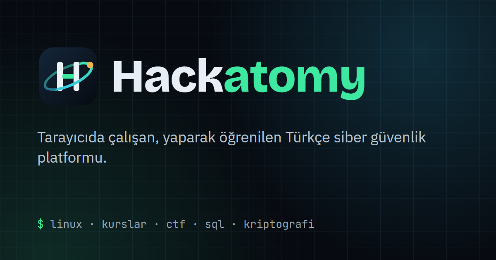

  

  <a href="https://hackatomy.nemesis-cybersec.workers.dev"><b>Siteye git</b></a> ·
  <a href="https://github.com/hackatomy/Hackatomy"><b>Kaynak kod</b></a> ·
  <a href="https://github.com/hackatomy/Hackatomy/blob/main/CONTRIBUTING.md"><b>Katkı rehberi</b></a> ·
  <a href="https://github.com/hackatomy/Hackatomy/blob/main/SECURITY.md"><b>Güvenlik bildirimi</b></a>

---

**Hackatomy**, İstanbul Aydın Üniversitesi Siber Güvenlik Kulübü öğrencileri için hazırlanan, tarayıcıda çalışan bir siber güvenlik eğitim platformudur. Kurulum gerekmez: Linux terminali, SQL, Python ve ağ alıştırmaları doğrudan sayfada çalışır.

### Platformda neler var?

| Bölüm | İçerik |
|---|---|
| 🐧 **Linux** | Tarayıcıda gerçek Linux (v86), komut görevleri ve kalıcı dosya sistemi |
| 📚 **Kurslar** | Kurs → Ünite → Ders düzeninde Türkçe içerik, testler ve uygulamalar |
| 🗄️ **SQL ve SQL Injection** | Örnek veritabanında sorgu yazma, açığı bulma ve kapatma |
| 🌐 **Ağ** | Ağ laboratuvarı, paket analizi, 3D SimRoom |
| 🔐 **Kriptografi** | Klasik şifrelerden özet fonksiyonlarına alıştırmalar |
| 🚩 **CTF** | Kulüp içi yarışmalar ve sezon ligi |
| 🧑‍🏫 **Eğitmen paneli** | Sınıf, öğrenci ilerlemesi ve ders notu kütüphanesi |

Arayüz Türkçe ve İngilizcedir.

### Katkı vermek istersen

1. [Katkı rehberini](https://github.com/hackatomy/Hackatomy/blob/main/CONTRIBUTING.md) oku.
2. Kendi dalını aç (`ozellik/…`, `duzeltme/…`, `icerik/…`), değişikliğini yap, `npm test` çalıştır.
3. Pull request aç. Testler geçip bir ekip üyesi onaylayınca `main` dalına alınır ve siteye çıkar.

Güvenlik açığı bulduysan herkese açık issue açma; [SECURITY.md](https://github.com/hackatomy/Hackatomy/blob/main/SECURITY.md) içindeki yolu izle.

Vanilla JS · Cloudflare Workers · Supabase (PostgreSQL + RLS)
